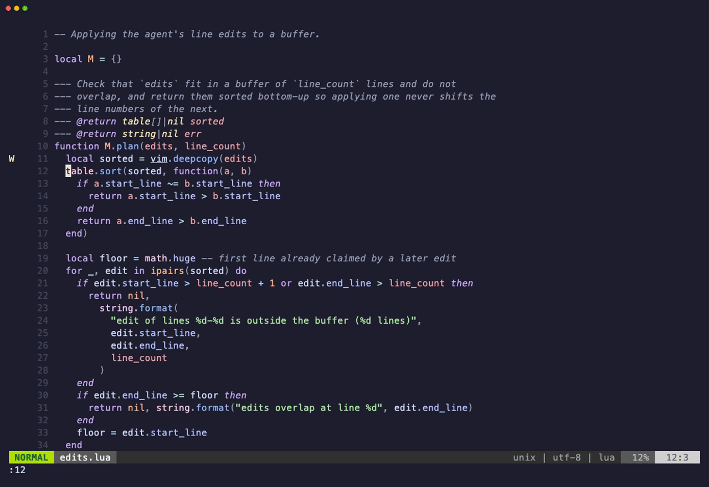

# agent-mode.nvim

Ask your coding agent about the code under your cursor, or tell it what to
change, without leaving Neovim. Answers show up right below the line you asked
about, and changes land in the buffer as one undo step.

Works with the agent you already use: **Claude Code**, **Codex**, **OpenCode**,
or **pi**. [agent-mode.leostera.dev](https://agent-mode.leostera.dev)



<sub>Sped up: the waits for the agent are cut.</sub>

## Why

When you are reading code and something is unclear, or you know exactly what
change you want, switching to a chat window means copying context, explaining
where you are, and copying the result back. agent-mode skips all of that:

- **Ask where you are.** Put the cursor on a line, press your key, type a
  question. The agent sees the file, your cursor, your selection, the
  diagnostics on the line, and what your language server can do there.
- **Read the answer in context.** It renders as Markdown right under the line,
  moves with the code, and never touches the file. Press `<CR>` on the line to
  step into it and yank from it.
- **Change code in place.** "rename to presenter", "extract this into a
  function", "add error handling". Renames go through your language server
  when one is attached; other changes are applied to the buffer as a single
  undo step.
- **Keep the thread.** Every request from one Neovim goes to the same
  conversation, so "do the same for the second caller" or "why did you
  pick that name?" just work.
- **Keep going.** Fire off as many requests as you like while you move through
  the file. Each shows a live status next to its line, and each answer or edit
  lands next to the line it was about, even as lines move.

## How it compares

Other plugins bring agents into Neovim too. They are built around a chat, a
sidebar, or the agent's own terminal; agent-mode is built around the line you
are on.

| | Where you talk to it | Where answers go | How edits land | Models | Language server |
| --- | --- | --- | --- | --- | --- |
| **agent-mode.nvim** | A box under the cursor | Under the line you asked about | Straight into the buffer, one undo step; several requests at once | The agent CLI you use (Claude Code, Codex, OpenCode, pi) | The agent can pick a rename or code action |
| [codecompanion.nvim](https://github.com/olimorris/codecompanion.nvim) | Chat buffer, inline prompt | Chat buffer | Diff to accept or reject | Model APIs, and CLI agents over ACP | Diagnostics as context |
| [avante.nvim](https://github.com/avante-corp/avante.nvim) | Sidebar | Sidebar | Suggested diff to apply | Model APIs, and CLI agents over ACP | Not documented |
| [sidekick.nvim](https://github.com/folke/sidekick.nvim) | The agent's terminal in a split | The agent's terminal | The agent edits files | Any agent CLI, plus Copilot next-edit suggestions | Copilot's suggestions |
| [opencode.nvim](https://github.com/nickjvandyke/opencode.nvim) | Prompt sent to OpenCode | OpenCode's interface | OpenCode edits; accept, reject, reload | OpenCode | No |
| [claudecode.nvim](https://github.com/coder/claudecode.nvim) | Claude Code's terminal | Claude Code's terminal | Diff to accept or reject | Claude Code | No |
| [gp.nvim](https://github.com/Robitx/gp.nvim) | Command or chat buffer | Chat buffer, popup, or the buffer | Rewrite, append, or prepend text | Model APIs | No |

Pick a chat plugin when you want a long conversation about a codebase. Pick
agent-mode when you want a quick answer or change at the line you are on.

## Install

Requires Neovim 0.12+ and one of the agent CLIs below, installed and logged in.
It uses [snacks.nvim](https://github.com/folke/snacks.nvim) for the prompt and
the settings menu; lazy.nvim installs it for you.

With [lazy.nvim](https://github.com/folke/lazy.nvim):

```lua
{
  "leostera/agent-mode.nvim",
  keys = {
    { "<leader>a", "<Plug>(AgentMode)", mode = { "n", "x" }, desc = "Ask the agent" },
  },
  opts = {
    agent = "claude", -- "claude", "codex", "opencode", or "pi"
  },
}
```

agent-mode maps no keys on its own: map `<Plug>(AgentMode)` to whatever you
like. Without lazy.nvim, install it any way you like and add:

```lua
vim.keymap.set({ "n", "x" }, "<leader>a", "<Plug>(AgentMode)")
vim.g.agent_mode = { agent = "claude" } -- optional; no setup() call needed
```

Then put the cursor somewhere, press your key, and type. `:checkhealth
agent_mode` checks your setup, and `:h agent-mode` has the full docs.

## Pick your agent

agent-mode runs your agent's CLI once per request with its usual tools (pi
also gets codemode), so it can read, search, and change your project, plus
agent-mode's own tools for working in your Neovim (served over MCP). The
buffer you asked from changes only through those tools, as one undo step,
since it may have unsaved edits; other open files the agent changes are
reloaded for you. Each run continues the same
session, so the agent remembers earlier requests (see
[One session per Neovim](#one-session-per-neovim)). Your agent's own
login, model access, and billing are used as they are.

| Agent | `agent =` | How it runs | `thinking` |
| --- | --- | --- | --- |
| [Claude Code](https://docs.anthropic.com/claude-code) | `"claude"` | `claude --print --permission-mode acceptEdits`, `--session-id`/`--resume`, only agent-mode's MCP server | `--effort`: `low` … `max` |
| [Codex](https://github.com/openai/codex) | `"codex"` | `codex exec --sandbox workspace-write`, then `codex exec resume <id>` | `model_reasoning_effort`: `minimal` … `high` (default `low`) |
| [OpenCode](https://opencode.ai) | `"opencode"` | `opencode run --standalone --auto --session <id>` | n/a |
| [pi](https://pi.dev) | `"pi"` | `pi --print --tools +codemode --extension pi/agent-mode.ts --session-id <id>` | `off` … `xhigh` (default `off`) |
| anything else | a function | see [Custom agents](#custom-agents) | |

Choose a model with `model`, in the format your agent expects:

```lua
opts = {
  agent = "claude",
  model = "sonnet",
  thinking = "low",
}
```

If the CLI is not on Neovim's `PATH` (common when Neovim starts from a GUI),
point at it with `cmd = vim.fn.expand("~/.local/bin/claude")`.

## Use

| Key | Where | What |
| --- | --- | --- |
| your `<Plug>(AgentMode)` key | normal, visual | Ask about, or change, the code at the cursor (or the selection) |
| `<CR>` | on a line with an answer | Step into the answer to scroll, select, and yank; `q` to go back |
| `]a` / `[a` | while answers are shown | Jump to the next / previous answer |
| `<Esc>` | while answers are shown | Dismiss the answer nearest the cursor |

The answer keys exist only in buffers that show an answer, so they do not
change your mappings anywhere else.

One command, `:AgentMode`, with completion for its subcommands:

- `:AgentMode`: open the prompt
- `:AgentMode ask {instruction}`: run an instruction at the cursor
- `:AgentMode cancel`: stop the requests on the cursor line, or all of them
- `:AgentMode dismiss[!]`: clear the answer nearest the cursor (all with `!`)
- `:AgentMode agent [name]`: show or switch the agent
- `:AgentMode config`: a menu to change the agent, model, thinking, Lua,
  session, and prompt settings, start a new session, or copy your
  settings as Lua for your config. It is drawn by
  [snacks.nvim](https://github.com/folke/snacks.nvim)'s picker, so every list
  is fuzzy-searchable (pi's models, for one); without snacks it falls back to
  `vim.ui.select`
- `:AgentMode new`: start a new session with the agent, and let go of an
  attached one
- `:AgentMode attach`: how to attach an agent you run yourself (see
  [Use the agent you already have open](#use-the-agent-you-already-have-open))
- `:AgentMode log`: show the last prompt, command, session, and output

## One session per Neovim

Every request from one Neovim goes to the same agent session, so you can
build on earlier ones: ask why a function exists, then "rename it to match
what you just said"; have it find the callers, then "add a test for the
second one". Each request still shows the agent the buffer as it is now.

The session starts with your first request. It lives in your agent's own
history, so you can open it there later (`claude --resume`, `pi --resume`,
`codex resume`, `opencode`), and it ends when you quit Neovim or run
`:AgentMode new`.

So that each reply lands in the right place in the conversation, requests in a
session run one at a time: a request asked while another is running shows
"queued" by its line and starts when the first finishes. For requests that
don't need each other, `session = { enabled = false }` runs each one on its own and all at
once, as before.

## Use the agent you already have open

The agent you work with all day, in Ghostty, tmux, or anywhere else, can take
your requests too, with everything it already knows about the task. agent-mode
serves its tools to any agent over MCP: add the server once, then tell the
agent to listen.

1. Add agent-mode's MCP server to your agent (`:AgentMode attach` shows these
   with the paths filled in):

   ```sh
   pi install /path/to/agent-mode.nvim/pi/agent-mode.ts
   claude mcp add --scope user agent-mode -- /path/to/agent-mode.nvim/bin/agent-mode-mcp
   codex mcp add agent-mode -- /path/to/agent-mode.nvim/bin/agent-mode-mcp
   ```

   For OpenCode, add it to `~/.config/opencode/opencode.json`:
   `"mcp": { "agent-mode": { "type": "local", "command": ["/path/to/agent-mode.nvim/bin/agent-mode-mcp"] } }`.

2. Start the agent in your project's folder and tell it: "Listen to Neovim:
   call agent-mode's wait_for_request tool, handle each request it returns
   with agent-mode's tools, and call wait_for_request again after each one,
   until I say stop." (`:AgentMode attach` copies this for you.)

While it listens, requests you make at your cursor go to it instead of a new
agent. The server finds your Neovim by the folder the agent runs in (each
Neovim registers itself in its state folder when agent-mode loads; with
lazy.nvim, add `event = "VeryLazy"` so that happens at startup rather than on
your first request), or by `$NVIM` inside Neovim's terminal. Without the listening loop, the agent can still use the tools when
you ask it to in its own window: "look at what I have selected in Neovim",
"rename this with the language server".

When no agent is attached, `session.mode` says what a request does:
`"start"` (the default) starts your agent as usual, `"attach"` waits for one
to attach and shows how, and `"ask"` asks each time. `:AgentMode new` lets go
of the attached agent.

## Let the agent look around and show you things

Some requests need more than the file you are in: "show me the call graph
starting here", "where else is this used?", "open the tests for this in a
split". The agent splits the work:

- **Its own tools** for anything on disk: it reads, searches, and changes
  other files in your project (with codemode in pi) the way it always does,
  like adding a test file or updating callers elsewhere.
- **Lua in your Neovim** for what only Neovim has: your language servers,
  unsaved buffers, windows and plugins, and showing you the result in a tab,
  a split, or the quickfix list.

What the Lua returns or prints goes back to the agent, which takes another
step or answers. Asked for the
call graph of a function, pi searched the project for the callers five
levels up with its tools, then sent one piece of Lua to open the graph in a
new tab.

The agent's code works like a code mode:

- `describe()` lists what your Neovim has: its version, the language servers
  on the buffer, your plugins, and helpers.
- `describe("lsp")`, `describe("plugins")`, `describe("commands")`,
  `describe("keymaps")` and `describe("treesitter")` give the details, and
  `describe("telescope.builtin")` lists any module's functions.
- The prompt already includes a one-line summary: the Neovim version, the
  language servers and which of call hierarchy, references, definition and
  type hierarchy each supports, and your lazy.nvim plugins.
- Helpers keep the code short:
  - `am.scratch(lines, { open = "tab" })` shows results in a scratch buffer
    (`q` closes it).
  - `am.lsp(method, params, callback)` asks the buffer's language servers.
  - `am.lines(path)` reads a buffer or file.
- `ctx` says where you are (buffer, window, line, column, selection), and
  `ctx.async()` lets the code wait for language servers or processes without
  blocking the editor.

By default agent-mode shows the code first: `y` runs it, `a` runs it and the
rest of that request's code, and `n` skips it (the agent is told). Set
`luamode = "allow"` to skip the question, or `luamode = false` to not offer Lua at all.
The code runs with your editor's full permissions, so keep the question on if
you ask about code you don't trust: a file can contain text that tries to
steer the agent.

## Configuration

Everything is optional, and no `setup()` call is needed. Set `vim.g.agent_mode`
(a table, or a function returning one) anywhere in your config, or pass the
same table to `setup()` (lazy.nvim's `opts` does that). These are the
defaults:

```lua
vim.g.agent_mode = {
  agent = "pi",            -- "claude", "codex", "opencode", "pi", or a function
  cmd = nil,               -- path to the agent's executable
  model = nil,             -- nil: the agent's default
  thinking = nil,          -- reasoning level, passed to the agent
  system_prompt = nil,     -- your own instructions, added to agent-mode's
  args = {},               -- extra CLI arguments for the agent
  input = "cursor",        -- "cursor": prompt below the cursor; "cmdline": vim.ui.input
  answer_keymaps = { enter = "<CR>", dismiss = "<Esc>", next = "]a", prev = "[a" },
  max_lines = 2000,        -- longer buffers are sent as a window around the cursor
  code_action_timeout_ms = 1000,
  luamode = "confirm",     -- let the agent run Lua: "confirm", "allow", or false
  luamode_timeout_ms = 10000, -- how long its asynchronous Lua may take
  session = {
    enabled = true,        -- one agent session for every request from this Neovim
    mode = "start",        -- with no agent attached: "start" one, "attach" (wait), or "ask"
  },
}
```

Typos and unknown keys show up in `:checkhealth agent_mode`.

Change settings while Neovim runs; `configure()` keeps everything you do not
pass:

```vim
:AgentMode agent codex
:lua require("agent_mode").configure({ model = "opus", thinking = "high" })
:lua require("agent_mode").configure({ system_prompt = "Prefer small, idiomatic changes." })
```

Answers use the `AgentModeAnswer`, `AgentModeAnswerBorder`, and
`AgentModeAnswerTitle` highlight groups, and the prompt uses `AgentModeInput`,
`AgentModeInputBorder`, and `AgentModeInputTitle`. They link to your floating
window colors by default.

### Custom agents

`agent` can be a function that turns a request into a command. Give the
agent agent-mode's MCP server (`request.mcp.command` with `request.mcp.args`)
so it can edit and answer; if it does neither, what it prints on stdout is
shown as the answer:

```lua
agent = function(request)
  -- request: { system_prompt, prompt, model, thinking, args, session, mcp }
  return {
    argv = { "my-agent", "--quiet", "--mcp", request.mcp.command .. " " .. table.concat(request.mcp.args, " ") },
    stdin = request.system_prompt .. "\n\n" .. request.prompt,
  }
end
```

## How it works

1. agent-mode snapshots the buffer, cursor, selection, and diagnostics, and
   asks your language servers whether they can rename here and which code
   actions they offer.
2. The agent gets all of that with your instruction, and works in Neovim
   through agent-mode's MCP tools: `edit` (line edits), `lsp_rename`,
   `code_action`, `show_answer` (Markdown under your line), `set_status`
   (what it is doing, next to the line), and `run_lua`, whose result comes
   straight back to it.
3. Edits are applied only if the lines they replace are still exactly what
   the agent saw (after accounting for lines that moved), so a slow agent
   never clobbers what you typed; when they changed, the agent is told and
   can look again.

The buffer you asked from only changes through those tools, each edit one
undo step; files the agent changes with its own tools are reloaded in any
open buffer. The MCP server is `bin/agent-mode-mcp`: a small headless Neovim
that relays each tool call to your Neovim over its RPC socket.

## Hand requests to an agent session you already have open

If you run an agent next to Neovim in [Axo](https://github.com/leostera/axo),
agent-mode can send requests to that session instead of starting a new agent
each time (`agent = "axo"`). That agent works with its own tools and its whole
conversation as context; agent-mode saves the buffer first, shows the agent's
steps next to the line, and brings the buffer up to date, or shows the reply
inline when it only answered.

```lua
opts = {
  agent = vim.env.AXO_SESSION_ID and "axo" or "claude",
  axo = { session = "self" },
}
```

## Development

`make test` runs the unit and integration tests in headless Neovim, and
`make typecheck` checks the LuaCATS types with lua-language-server; CI runs
both.

```sh
make test                                  # unit + integration tests
make test-live AGENTS=claude,codex,opencode,pi   # against real agents; costs tokens
```

The integration tests use a scripted agent, and a real `lua-language-server`
when one is installed (on `PATH` or through mason).

## License

MIT. See [LICENSE](LICENSE).
